<!-- GENERATED FILE — edit profile.config.yml and run `npm run generate` (see docs/CUSTOMIZATION.md). -->

<picture>
  <source media="(prefers-color-scheme: light)" srcset="assets/generated/hero-light.svg">
  
</picture>

<a href="#focus">Focus</a> &nbsp;·&nbsp; <a href="#featured-work">Work</a> &nbsp;·&nbsp; <a href="#after-hours">After hours</a> &nbsp;·&nbsp; <a href="#github-intelligence">Intelligence</a> &nbsp;·&nbsp; <a href="#recent-work">Recent</a> &nbsp;·&nbsp; <a href="#explore">Explore</a>

Cybersecurity, software engineering and research — building security tooling and learning in public.

## Focus


## Featured work

<table>
<tr><td width="50%" valign="top"><a href="https://github.com/itssourov13/passhunter">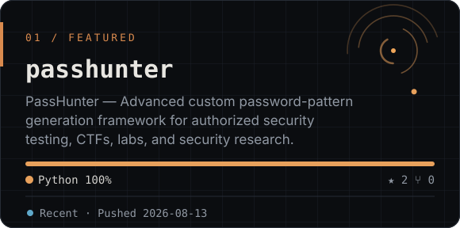</a></td><td width="50%" valign="top"><a href="https://github.com/itssourov13/cyberos">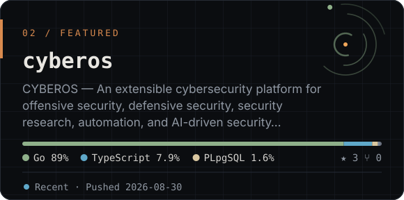</a></td></tr>
</table>

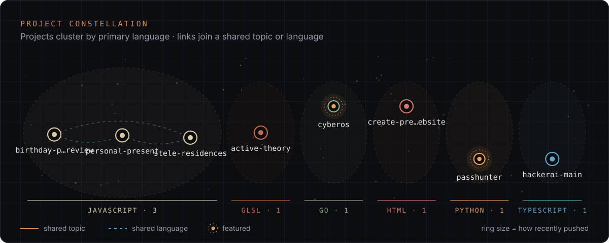

## After hours

 
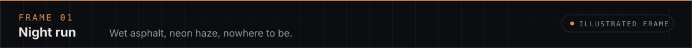

## GitHub intelligence

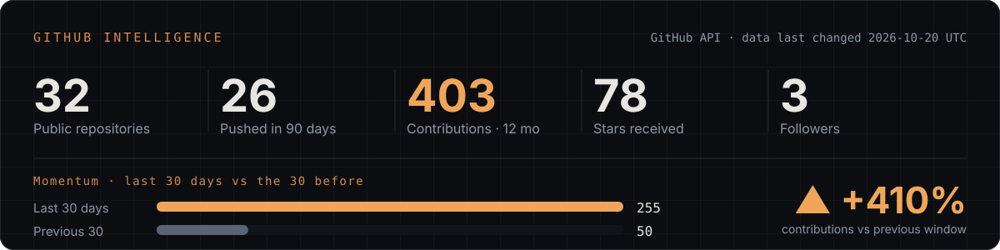

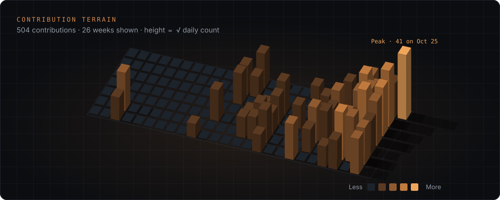

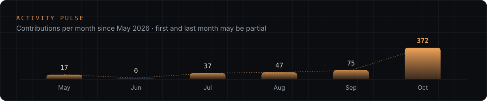

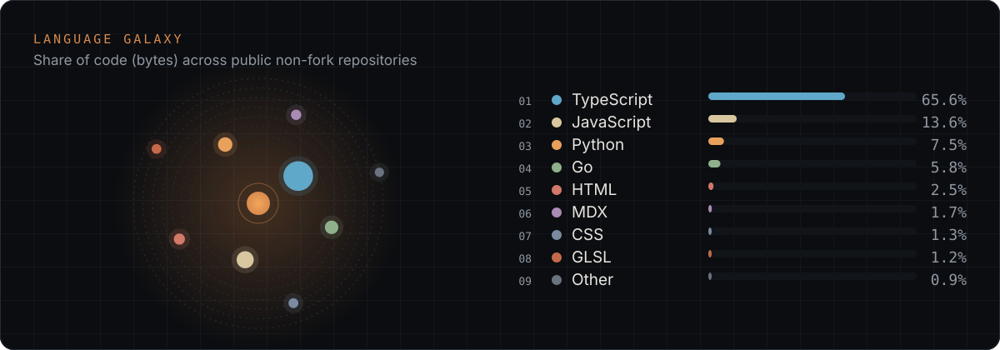

## Recent work

| Repository | Description | Language | Status | Last push |
| --- | --- | --- | --- | --- |
| [hackerai-main](https://github.com/itssourov13/hackerai-main) | Official HackerAi - "Production-grade AI-powered cybersecurity assistant with autonomous pentesting… | TypeScript | Active | 2026-10-28 |
| [my-awesome-projects](https://github.com/itssourov13/my-awesome-projects) | A visual portfolio showcasing my software, cybersecurity, web development, and creative projects wi… | Python | Active | 2026-10-28 |
| [bd-admission-app](https://github.com/itssourov13/bd-admission-app) | Admission app | TypeScript | Active | 2026-10-28 |
| [personal-website-pentest](https://github.com/itssourov13/personal-website-pentest) | A deliberately vulnerable web application for hands-on penetration testing, vulnerability research,… | TypeScript | Active | 2026-10-26 |
| [personal-website-test](https://github.com/itssourov13/personal-website-test) | Personal website . Build with Next js. | TypeScript | Active | 2026-10-22 |
| [cinematic-architecture-web](https://github.com/itssourov13/cinematic-architecture-web) | A cinematic architectural website experiment combining immersive imagery, editorial typography, and… | JavaScript | Active | 2026-10-21 |

Selected automatically from public repositories by most recent push. Status: Active ≤ 30 days · Recent ≤ 90 · Quiet ≤ 1 year · Dormant beyond, measured at the last data update.

Archived &amp; excluded (2)

| Repository | Reason | Last push |
| --- | --- | --- |
| [js.org](https://github.com/itssourov13/js.org) | Fork | 2026-08-19 |
| [awesome](https://github.com/itssourov13/awesome) | Fork | 2026-06-30 |

## Explore

<a href="https://itssourov13.github.io/itssourov13/"></a>

<a href="https://itssourov13.github.io/itssourov13/"><b>↗ Open the 3D World</b></a>

<b>Connect</b> &nbsp;·&nbsp; <a href="https://github.com/itssourov13">GitHub</a> &nbsp;·&nbsp; <a href="https://www.linkedin.com/in/itssourov13">LinkedIn</a> &nbsp;·&nbsp; <a href="https://x.com/itssourov13">X</a> &nbsp;·&nbsp; <a href="https://www.facebook.com/itssourov13">Facebook</a> &nbsp;·&nbsp; <a href="https://www.instagram.com/itssourov13">Instagram</a> &nbsp;·&nbsp; <a href="https://itssourov13.vercel.app/">Website</a>

GitHub data last changed 2026-10-28 UTC · generated by the <a href="docs/ARCHITECTURE.md">profile engine</a> · <a href="https://github.com/itssourov13">@itssourov13</a>

